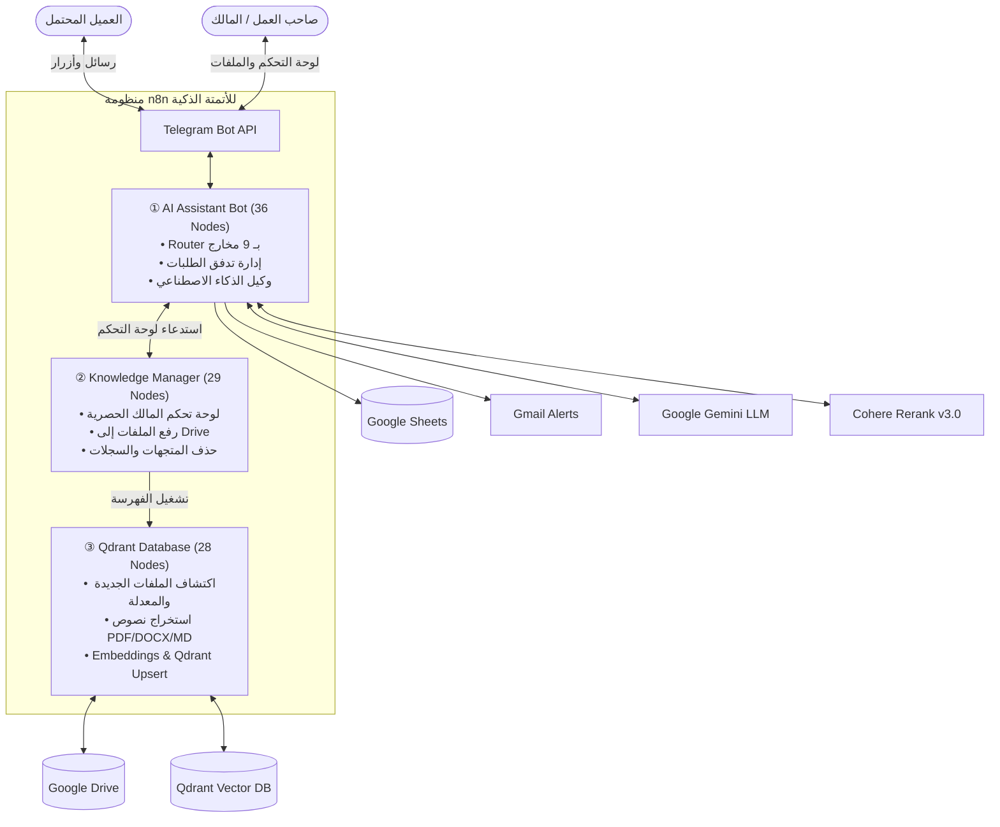
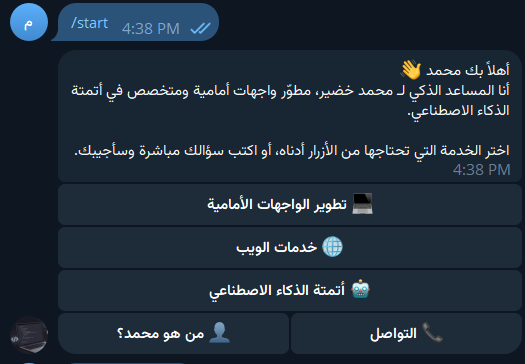
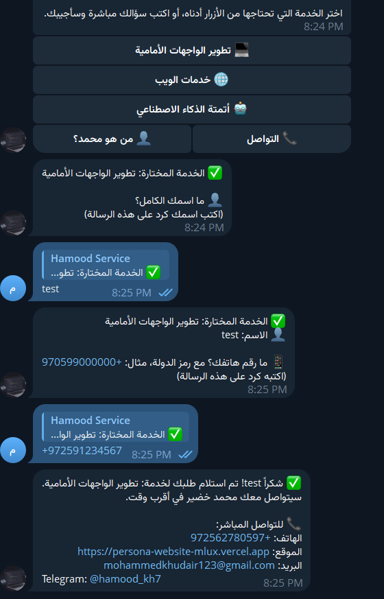
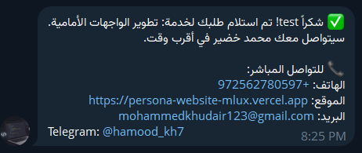
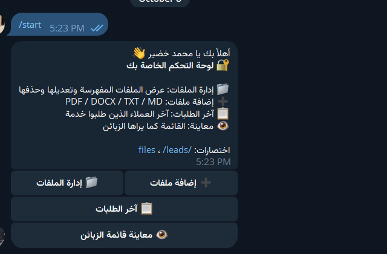
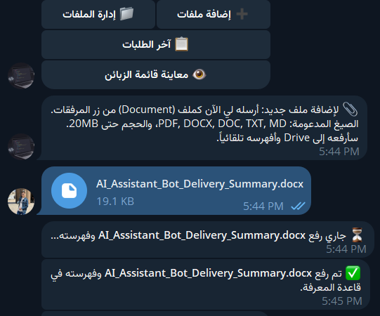
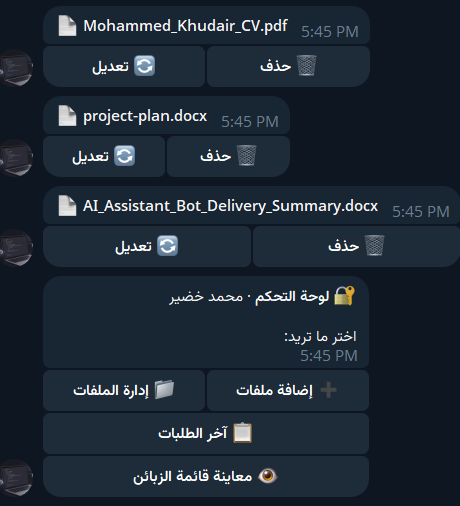
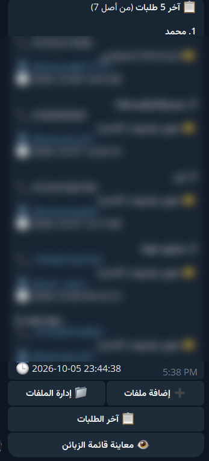
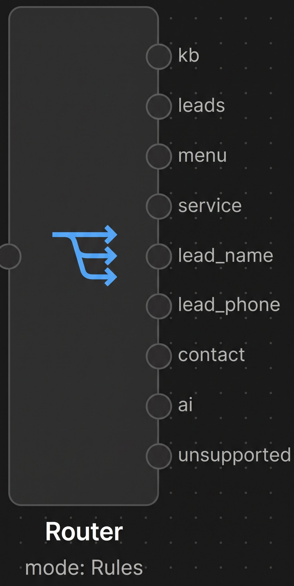
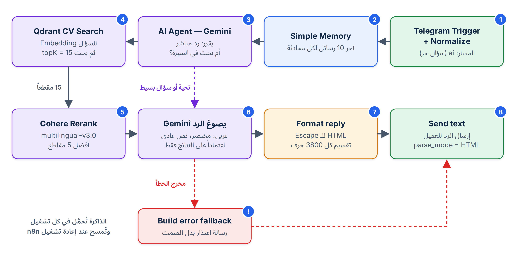

# 🤖 AI Assistant Bot
### بوت تيليجرام ذكي بواجهتين (عميل ومالك) مدعوم بتقنية RAG وأتمتة التقاط العملاء

[-DC2626?style=for-the-badge&logo=qdrant&logoColor=white)](https://qdrant.tech/)
[-39594C?style=for-the-badge)](https://cohere.com/)

  <b>مشروع التخرج المعتمد · تدريب الذكاء الاصطناعي والأتمتة</b> 
  جامعة النجاح الوطنية · برنامج الأمم المتحدة الإنمائي (UNDP) · مركز شؤون المرأة - غزة

**إعداد وتطوير:** م. محمد خضير &nbsp;|&nbsp; **إشراف:** م. مهند هندي &nbsp;|&nbsp; **تاريخ الاعتماد:** 11 أكتوبر 2026

---

## 📊 إحصائيات وأرقام المنظومة (Key Metrics)

| 👥 الواجهات | 🔄 التدفقات البرمجية | 🧩 العقد المؤتمتة | 🔀 مسارات التوجيه | ⚡ زمن الاستجابة |
| :---: | :---: | :---: | :---: | :---: |
| **واجهتان (عميل ومالك)** | **3 فلوهات مترابطة** | **93 عقدة في n8n** | **9 مسارات في Router** | **فوري على مدار 24/7** |

---

## 🎯 1. المشكلة والحل (Problem & Solution)

| قبل الأتمتة (Before) | بعد تطبيق النظام (After) |
| :--- | :--- |
| • العميل المحتمل يسأل نفس الأسئلة المتكررة حول الهوية والخدمات. | • **واجهتان مستقلتان:** واجهة عميل تفاعلية وواجهة مالك إدارية بنفس البوت. |
| • الرد اليدوي غير الفوري مما يضيع فرص عمل وعملاء مؤكدين. | • **رد ذكي فوري 24/7** يستند بدقة للمستندات دون أي اختلاق (Zero Hallucination). |
| • الطلبات تُكتب يدوياً في المحادثات فتضيع أو تتأخر متابعتها. | • **التقاط آلي للبيانات (Lead Capture):** حفظ فوري بالـ Sheets مع إشعار Gmail وتيليجرام. |
| • تحديث بيانات السيرة أو المعرفة يتطلب تدخلاً تقنياً معقداً. | • **إدارة معرفة لحظية:** المالك يرفع المستندات من تيليجرام وتُفهرس فوراً في Qdrant. |

---

## 🏛️ 2. البنية المعمارية للتدفقات الثلاثة (System Architecture)

تم تقسيم المنظومة هندسياً إلى 3 فلوهات فرعية داخل n8n لضمان استقرار الأداء وعزل الأخطاء:

| # | التدفق | المسؤولية |
|---|--------|-----------|
| ① | **AI Assistant Bot** (36 عقدة) | استقبال الرسائل، تمييز المالك من العميل (Normalize)، التوجيه عبر Router بتسعة مخارج، تسجيل الطلبات، وكيل الذكاء الاصطناعي، وتنبيه الأخطاء (Error Trigger) |
| ② | **Knowledge Manager** (29 عقدة) | لوحة المالك: عرض الملفات، رفع من تيليجرام إلى Drive، حذف المتجهات والملف والسجل، والتحقق من نجاح الفهرسة |
| ③ | **Qdrant Database** (28 عقدة) | اكتشاف الملفات الجديدة والمعدّلة، استخراج النص، التقطيع، Embeddings من Gemini، والتخزين في Qdrant مع تسجيل الشيت |

---

## 👤 3. واجهة العميل (Customer Interface)

العميل يرى قائمة أزرار بسيطة (الخدمات، «من هو محمد؟»، «التواصل») ويستطيع كتابة أي سؤال حر في أي وقت ليجيب عنه الـ AI Agent من السيرة الذاتية. ولا يرى أي أمر إداري.

| القائمة الرئيسية | رحلة تسجيل الطلب | تأكيد الطلب |
|:---:|:---:|:---:|
|  |  |  |

**رحلة تسجيل الطلب:** `الخدمة` ← `الاسم` ← `الهاتف` ← `تأكيد`

- التحقق من الاسم والهاتف، وإعادة السؤال عند الخطأ
- الطلب يُحفظ في Google Sheets ويصل المالك عبر Gmail وتيليجرام
- الحالة تُستنتج من الرد (Reply) على رسالة البوت، فلا حاجة لقاعدة بيانات لحفظ الحالة

---

## 🔐 4. واجهة المالك (Owner Interface)

يتعرّف البوت على المالك من معرّف حسابه عند `/start`، فتظهر له لوحة تحكم داخل تيليجرام. هذه الأوامر والأزرار للمالك فقط، والعميل لا يصل إليها.

| لوحة المالك | رفع وفهرسة ملف | إدارة الملفات | آخر الطلبات |
|:---:|:---:|:---:|:---:|
|  |  |  |  |

| الزر | الوظيفة |
|------|---------|
| 📁 **إدارة الملفات** | عرض الملفات المفهرسة مع تعديل وحذف بتأكيد |
| ➕ **إضافة ملفات** | رفع PDF · DOCX · DOC · TXT · MD حتى 20MB مع فهرسة فورية في Qdrant |
| 📋 **آخر الطلبات** | آخر 5 طلبات مع الإجمالي |
| 👁 **معاينة الزبائن** | عرض القائمة كما يراها العميل |

> 🚨 عند فشل أي workflow يصل المالك تنبيه تيليجرام تلقائي.

---

## 🔀 5. الـ Router: تسعة مسارات

| المخرج | الوظيفة |
|--------|---------|
| `service` · `lead_name` · `lead_phone` | تسجيل الطلب خطوة بخطوة |
| `menu` · `contact` | القائمة وبيانات التواصل |
| `ai` | السؤال الحر ← AI Agent |
| `unsupported` | صور وملفات العميل |
| `kb` · `leads` | أوامر المالك فقط |

رسائل المجموعات تُتجاهل (`ignore`).

---

## 🧠 6. عقل الذكاء الاصطناعي (RAG Pipeline)

| المكوّن | الإعداد |
|---------|---------|
| **النموذج** | Google Gemini 3.5 Flash-Lite · حرارة 0.3 |
| **الذاكرة** | Simple Memory · آخر 10 رسائل لكل محادثة |
| **البحث الدلالي** | Qdrant · أفضل 15 مقطعاً (topK=15) |
| **إعادة الترتيب** | Cohere Rerank v3.0 · أفضل 5 مقاطع (topK=5) |
| **معالجة الأخطاء** | رسالة اعتذار للعميل بدل الصمت |

**مبدأ العمل:** يبحث الوكيل في قاعدة المعرفة، ثم تُعاد ترتيب النتائج بـ Cohere، ويجيب Gemini من أفضل المقاطع فقط. وإذا لم يجد المعلومة لا يختلق جواباً.

---

## 📥 7. خط الفهرسة وإدارة المعرفة

1. المالك يرسل ملفاً من تيليجرام ← يُرفع إلى **Google Drive**
2. **Knowledge Manager** يستدعي تدفق الفهرسة (`Run ingestion`)
3. اكتشاف الملفات الجديدة والمعدّلة ← استخراج النص (PDF · DOCX · TXT · MD)
4. تقطيع النص + **Embeddings** من Gemini
5. تخزين المتجهات في **Qdrant** وتسجيل الملف في الشيت
6. التحقق من نجاح الفهرسة وإبلاغ المالك

عند الحذف تُمسح المتجهات والملف والسجل معاً حتى لا تبقى بيانات يتيمة.

---

## ✅ 8. الاختبارات والقيود وخارطة الطريق

| ما اختُبر | القيود الحالية | خارطة الطريق |
|-----------|----------------|--------------|
| 12 سيناريو اختبار، 8 منها موثّقة بلقطات من تيليجرام | الذاكرة داخل n8n (Simple Memory) | `Schedule Trigger` لفهرسة Drive تلقائياً |
| واجهة العميل: قائمة، تواصل، «من هو محمد؟»، طلب كامل | الفهرسة تعمل عند الطلب فقط (بلا جدولة) | ذاكرة دائمة (Postgres أو Redis) |
| واجهة المالك: لوحة، طلبات، رفع ملف، إدارة الملفات | تحقق عام من الهاتف (8–15 رقماً) | منع تكرار الطلبات وتحديد المعدل |
| التحقق من المدخلات وصلاحيات المالك | لا منع لتكرار الطلبات | تقرير أسبوعي، لغات إضافية، حجز مواعيد |

---

## 🧰 9. التقنيات المستخدمة (Tech Stack)

| الطبقة | التقنية |
|--------|---------|
| الأتمتة والمنطق | n8n (3 workflows · 93 عقدة) |
| الواجهة | Telegram Bot API |
| النموذج اللغوي والـ Embeddings | Google Gemini |
| قاعدة المتجهات | Qdrant |
| إعادة الترتيب | Cohere Rerank v3.0 |
| التخزين والبيانات | Google Drive · Google Sheets |
| التنبيهات | Gmail · Telegram |

---

## 🏁 الخلاصة

بوت عربي بواجهتين يردّ فوراً من مصدر معرفة موثوق ويسجّل الطلبات تلقائياً، ويتيح للمالك إدارة المعرفة ومتابعة الطلبات من تيليجرام نفسه، دون أي أدوات تقنية.

> **ملاحظة:** هذا المستودع للعرض والتوثيق (Portfolio Showcase). ملفات الـ workflows وبيانات الاعتماد غير منشورة عمداً، وبيانات العملاء في اللقطات مموّهة.

---

## 👨‍💻 المطوّر

**م. محمد خضير (Mohammed Khudair)** — مطوّر واجهات أمامية وأخصائي أتمتة الذكاء الاصطناعي

- 🌐 الموقع: [persona-website-mlux.vercel.app](https://persona-website-mlux.vercel.app)
- ✈️ تيليجرام: [@hamood_kh7](https://t.me/hamood_kh7)
- 💼 GitHub: [@your-username](https://github.com/your-username) <!-- TODO: replace with your GitHub username -->

⭐ إذا أعجبك المشروع، لا تنسَ نجمة للمستودع!

